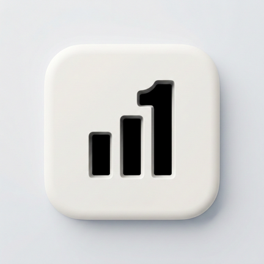

# trackOne — A privacy focused portfolio tracker for Android

<p align="center">
  
</p>

<p align="center">
  A minimal, dark-mode finance app and home-screen widget to track your<br/>
  watchlist, net worth, stocks, crypto, and more — local-first, with optional cloud backup.
</p>

<p align="center">
  
  
  
  
  
</p>

<p align="center">
  <a href="https://github.com/SaurabhChaudharyy/trackOne/releases/latest">
    
  </a>
</p>

---

## v1.0.0 — first release

*   **Net worth across 8 categories**: Indian Stocks, US Stocks, Mutual Funds, Gold, Silver, Crypto, Cash and Bank. Live prices for market-priced holdings, with each row showing quantity, average price, last price and today's move, and a sort control (value, P&L %, today).
*   **Portfolio history chart**: today's holdings priced against each day's actual close over 1D, 1W, 1M, 3M, 1Y and ALL, with the gain/loss line following the range you pick.
*   **Watchlist and home-screen widget**: track any stock or crypto symbol, with a scrollable widget that updates in the background.
*   **Broker import**: HDFC Securities, Angel One, Zerodha, Groww, Vested and Interactive Brokers, with the same holding at several brokers combined into one position, and holdings imported under a company name or ISIN resolved to a priceable ticker.
*   **Market-close digests (optional)**: a notification after each market closes, or a weekly summary. See [Notifications](#notifications).
*   **Private by design**: local-first, no account needed. Optional Google or email sign-in for cloud backup, optional biometric app lock, light/dark/system theme, and account deletion from Settings.
*   **Gentle on Yahoo Finance**: prices are requested once and shared, saved prices are reused while fresh, and rate limiting pauses requests instead of piling up retries.

---

## 📲 Download & Install

1. Tap the **Download APK** badge above (or go to [Releases](https://github.com/SaurabhChaudharyy/trackOne/releases/latest))
2. Download the `.apk` file onto your Android device
3. Go to **Settings → Install unknown apps** and allow installs from your browser or file manager
4. Open the `.apk` file and tap **Install**

> Requires Android 8.0 (Oreo) or higher. No Play Store — direct sideload only.

---


## Features

| Tab | What it does |
|---|---|
| **Markets / Watchlist** | Track any stock or crypto symbol. Live prices via Yahoo Finance. Tap any item for a full candlestick / line chart with 1D → 5Y timeframes. |
| **Net Worth** | Add assets across 8 categories (Indian Stocks, US Stocks, Mutual Funds, Gold, Silver, Crypto, Cash, Bank). Collapsible sections, each holding showing quantity, average price, last price and today's move. Auto-fetches current price for symbol-based assets, and auto-resolves holdings imported under a company name/ISIN to a priceable ticker. |
| **Settings** | Import holdings directly from your broker's CSV/XLSX export (HDFC Securities, Angel One, Zerodha, Groww, Vested, Interactive Brokers), with same-holding reconciliation across brokers. Optionally sign in with Google or email/password to back up your watchlist + net worth data to the cloud and restore it on another device. Toggle theme, biometric app lock, the portfolio digest (daily or weekly) and a twice-a-month reminder to update manual holdings. You can delete your account and cloud backup from Settings at any time. |
| **Home-screen Widget** | Scrollable stock list widget that updates in the background via WorkManager. Tap any row to open the detail screen. |

---

## Notifications

All notifications are opt-in from Settings, and none need an account.

**Portfolio Digest** has two frequencies, picked in Settings → Digest frequency:

*   **Daily**: two notifications each weekday, an hour after each market closes.
    *   **Indian market closed**, about 4:30 PM IST: your Indian stocks' move, Nifty 50 and Sensex, and your top and lagging holding.
    *   **US market closed**, an hour after the New York close: your US stocks' move, S&P 500 and Nasdaq, and your top and lagging holding. In India that is about 2:30 AM during US summer time and 3:30 AM in winter. It arrives silently so it doesn't wake you.
*   **Weekly**: one summary on Sunday around 10 AM with your total gain/loss since purchase and your best and worst holdings.

Gains and losses are coloured and the subject of each line is bold. Settings shows the exact times for your time zone.

**Portfolio Update Reminder**: twice a month, a nudge to update manually-tracked holdings and re-import broker CSVs.

---

## Tech Stack

| Layer | Library |
|---|---|
| Language | Kotlin |
| UI | Android XML Views + Material 3 |
| Architecture | MVVM |
| Database | Room (KSP) |
| Dependency Injection | Dagger Hilt (KSP) |
| Networking | Retrofit + OkHttp + Gson |
| Background work | WorkManager |
| Image loading | Glide |
| Charts | MPAndroidChart |
| Async | Kotlin Coroutines |
| Optional cloud backup | Firebase Auth + Cloud Firestore |
| Crash reporting | Firebase Crashlytics |

---

## Data & Privacy

- **Local-first by default**: all data is stored locally on your device in a Room (SQLite) database. No account is required to use the app.
- **No ads, no third-party trackers** — ever, whether or not you sign in.
- **Cloud Backup is entirely opt-in**: sign in with Google or email/password only if you want to back up your watchlist and net worth data to the cloud (Firestore) and restore it on another device. If you never sign in, nothing leaves your device.
- Stock/crypto prices are fetched from the public Yahoo Finance API — no API key required.
- **Crash reporting**: Firebase Crashlytics collects crash logs and basic device info (model, OS version, app version) to help fix bugs — this runs regardless of sign-in status, but never includes your portfolio data.
- Full details: see [PRIVACY.md](PRIVACY.md).

---

## Building

### Prerequisites
- Android Studio Hedgehog (2023.1.1) or newer
- JDK 17
- Android SDK 36

### Steps

```bash
# 1. Clone the repo
git clone https://github.com/SaurabhChaudharyy/trackOne.git
cd trackOne

# 2. Open in Android Studio — it will sync Gradle automatically
# OR build from the command line:
./gradlew assembleDebug

# 3. Install on a connected device / emulator
./gradlew installDebug
```

> **Note:** No API keys are needed. The app uses the public Yahoo Finance endpoint.

---

## Project Structure

```
app/src/main/
├── data/
│   ├── api/            # Retrofit service (Yahoo Finance)
│   ├── database/       # Room entities, DAOs, database class (schema v8)
│   ├── model/          # API response models
│   └── repository/     # StockRepository, NetWorthRepository, PortfolioHistoryRepository,
│                        # SymbolResolver/Matcher/Repairer, BrokerCsvRepository,
│                        # CloudBackupRepository, LocalDataRepository, AuthRepository
├── di/                 # Hilt AppModule + SecurityModule
├── security/           # AppLockManager (pure logic) + AppLockPrefs
├── notifications/      # NotificationHelper (channels + builders)
├── ui/
│   ├── config/         # Widget configuration activity
│   ├── detail/         # Stock detail screen + chart (container-transform transition)
│   ├── home/           # Home: portfolio value, history chart, today's movers, markets
│   ├── lock/           # Biometric/device-credential app-lock gate
│   ├── main/           # MainActivity, Watchlist fragment + adapter
│   ├── networth/       # Net Worth fragment + adapter + ViewModel
│   ├── settings/       # Settings fragment + AuthViewModel/CloudBackupViewModel/CsvImportViewModel, digest prefs
│   ├── splash/         # Splash screen + index prefetch
│   ├── util/           # Marker-design chart/UI helpers (dotted fill, reveal animation, money colour)
│   └── widget/         # AppWidgetProvider + RemoteViews service
├── utils/              # FormatUtils, Resource wrapper, PortfolioGainLoss, CurrencyConversion,
│                        # SymbolUtils, ChartRange/ChartAxis, HoldingQuality
└── workers/             # StockUpdateWorker, DailyDigestWorker (one run per market close), WeeklySummaryWorker,
                          # PortfolioReminderWorker, DigestSchedule/DigestScheduler (WorkManager)
```

---

## Known Limitations

- Yahoo Finance's public API is unofficial and may occasionally rate-limit or return stale data.
- The home-screen widget uses `RemoteViews`, which has strict constraints — complex layouts and custom attributes are not supported inside widget XMLs.
- Cloud Backup is manual and one-way in each direction, not continuous background sync — tapping **Restore** replaces local data with whatever's in your last cloud backup. Without signing in, there is currently no way to move data between devices other than re-importing your broker CSV/XLSX on the new device.
- Digest notifications are sent "around" their time: Android may delay background work to save battery, so they can arrive late. A market holiday is detected from Yahoo's session data and skips that digest, which is best-effort. A digest already in the shade keeps the colours it was posted with if you switch between light and dark mode.

---

## Contributing

Pull requests are welcome. For major changes, please open an issue first to discuss what you'd like to change.

1. Fork the repo
2. Create a feature branch (`git checkout -b feature/my-feature`)
3. Commit your changes (`git commit -m 'feat: add my feature'`)
4. Push to the branch (`git push origin feature/my-feature`)
5. Open a Pull Request

```
